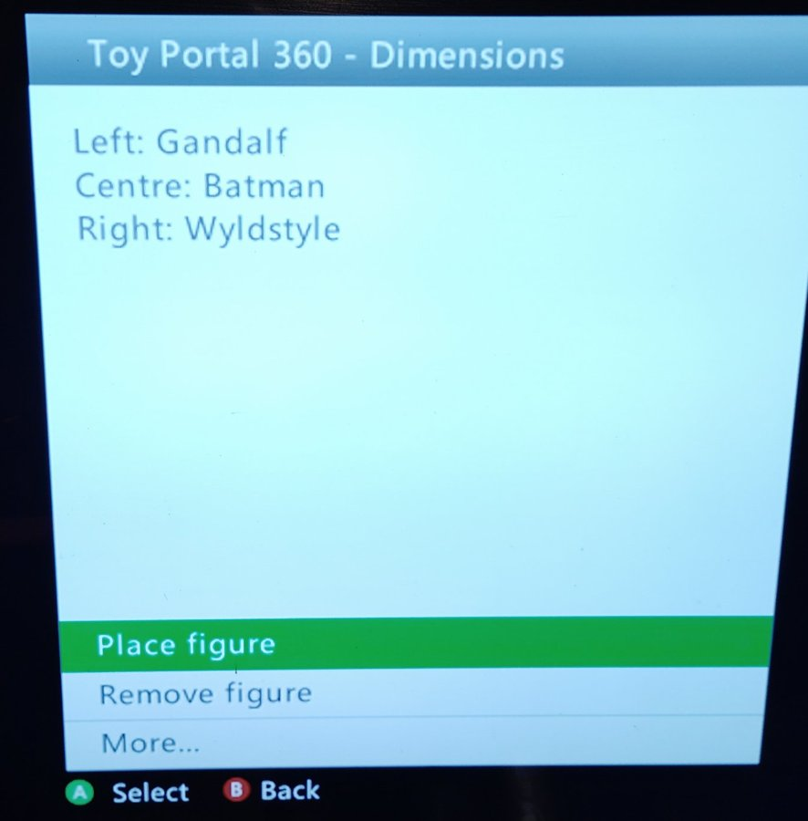
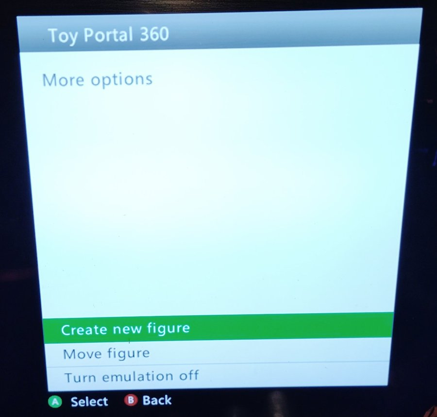
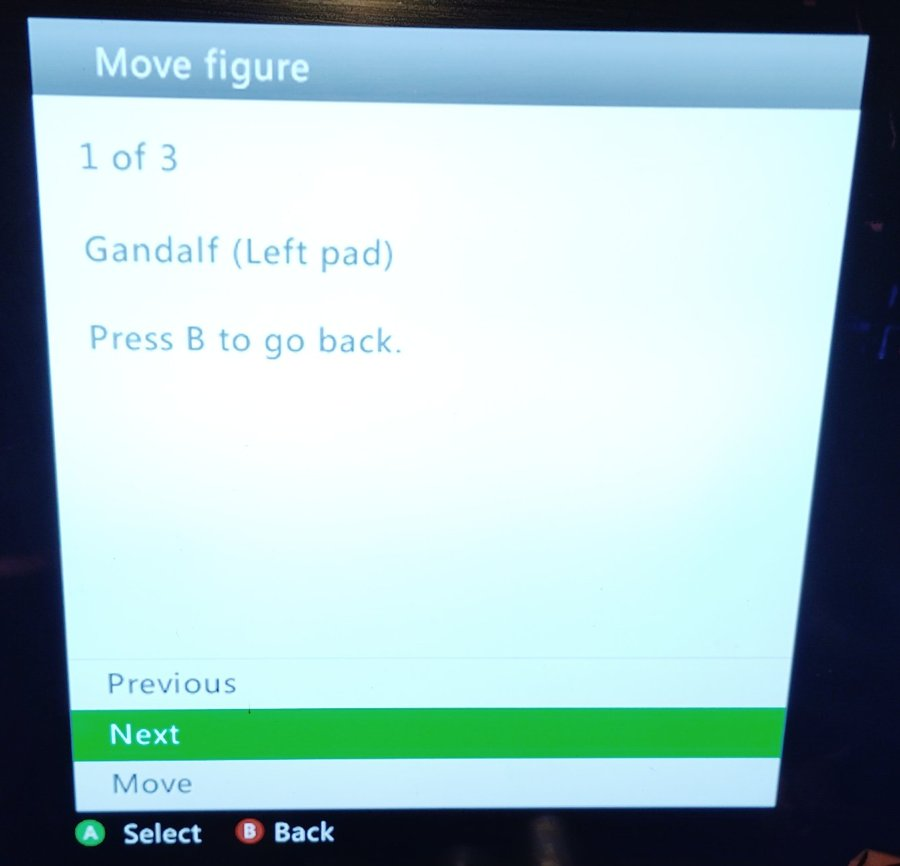

# ToyPortal360

A plugin for modded Xbox 360 consoles that fakes a **Skylanders Portal of Power**, a **LEGO Dimensions Toy Pad** or a **Disney Infinity Base**. You use figure files instead of the real hardware and toys, and pick them from an on-screen menu while you play. It works like the portal, toy pad and Infinity Base managers built into RPCS3.

> **Status: working on a real Xbox 360 with Peer Pressure and LEGO Dimensions.** Figures are created, placed on the virtual Toy Pad and played with. Skylanders, Disney Infinity and the DashLaunch build use the same code but haven't been tried on a console yet; reports are welcome in Issues.

## Screenshots

Photos of a real Xbox 360 running LEGO Dimensions under Peer Pressure, with three virtual figures on the Toy Pad. The menu opens over the game with LB + RB + Back.

| Main menu: what's on the pad | More options | Moving a figure between pads |
| --- | --- | --- |
|  |  |  |

## Download and quick start (Peer Pressure)

**[Download ToyPortal360-PeerPressure.zip](downloads/ToyPortal360-PeerPressure.zip?raw=true)**: the plugin, a ready-made `sideload.ini` for each game, and `HOW-TO-INSTALL.txt`.

1. Copy `ToyPortal360-PeerPressure.xex` and your game's `sideload.ini` (from `NextToGame/<game>/`) into the folder that holds the game's files. For a Games on Demand copy that's its `00007000` folder, for example `Hdd1:\Content\0000000000000000\LEGO Dimensions [5752084B]\00007000\`.
2. **Turn the console fully off and on, then start the game first.** Peer Pressure only sideloads into the first game started after power-on.
3. When "Toy Portal 360 ready" pops up, hold **LB + RB + Back** in the game for the menu. **More... → Create new figure**, type a name (for example `gandalf`), then **Place it** on a pad spot.

Figures are saved in `Hdd1:\ToyPortal\Dimensions\` (and `Skylanders\`, `Infinity\`), and the game saves progress into them. Don't edit `sideload.ini`: Peer Pressure ignored longer configs on the test console. Full details are in [Installing on Peer Pressure](#installing-on-peer-pressure).

## How it works

On the 360, toy games don't talk to the USB portal directly. They go through four functions in the system's XAM module:

| XAM export | Ordinal |
|---|---|
| `XamInputNonControllerGetRaw` | 0x4A1 |
| `XamInputNonControllerSetRaw` | 0x4A2 |
| `XamInputNonControllerGetRawEx` | 0x52A |
| `XamInputNonControllerSetRawEx` | 0x52B |

Xenia implements exactly these four functions to support the 360 Skylanders portal and Disney Infinity base, and a Xenia fork uses the `Ex` pair to run LEGO Dimensions with an emulated toy pad. Packets are 32 bytes each way. The 360 can wrap each frame as `<prefix> <length> <frame>`, for example `0B 11 55 0F B0 …` for Dimensions. The plugin detects this from the game's own writes and wraps its replies the same way.

ToyPortal360 runs a background thread. When a game that imports these functions starts, the plugin points the game's imports at its own functions. The game's commands then go to an emulated device, and the plugin sends back what a real portal would say. The emulated devices are ports of RPCS3's `Skylander.cpp`, `Dimensions.cpp` and `Infinity.cpp`. That includes each device's challenge/response, the Dimensions tag crypto, and the SHA-1 + AES figure encryption that Infinity uses. The plugin carries its own small SHA-1 and AES, because RPCS3's crypto library isn't available in an SDK build.

- **Device auto-detect:** the plugin works out the device from the game's first command. Skylanders commands are letters (`A`, `Q`, `W`, …), Dimensions packets start with `0x55`, and Infinity packets start with `0xFF`.
- **Other games pass through:** if a game speaks some other protocol, the plugin hands that game back to the real XAM functions, so its real hardware still works.
- **Saving:** figure changes the game makes (levels, upgrades, built vehicles) are written back to the figure files about every half second. The writes happen on the plugin's own thread, never the game's.

## Requirements

- An RGH or JTAG Xbox 360 running DashLaunch, **or** a console with the Peer Pressure softmod. Peer Pressure doesn't support Corona or Winchester boards.
- To build, either of:
  - the open-source [Xenon Forge](https://github.com/landaire/rust-xbox360) toolchain with clang/LLD (see below), or
  - Visual Studio 2010 with the Xbox 360 SDK (XDK).

## Building

There are two ways to build it. Both produce `ToyPortal360.xex`.

### With the open-source Xenon Forge toolchain (no Microsoft SDK)

[Xenon Forge](https://github.com/landaire/rust-xbox360) is an LLVM-based Xbox 360 toolchain that builds DLLs and system modules. `src/forge` adapts the plugin to it:
- an `xtl.h` that maps the SDK-style calls onto XAM and kernel exports, linked by ordinal
- a small C library and MSVC-style `printf`
- a `DllMain` that runs C++ constructors first
- thread start-up through raw kernel threads
- assembly entry points so the game can call the hooks. These keep the 64-bit registers the console expects.
- a trampoline for calling console functions by address. Console code writes its arguments into its caller's stack frame, which SysV code doesn't reserve.

1. Install clang and ld.lld (LLVM 18 or newer) and Rust's `cargo`.
2. Clone Xenon Forge. The build was checked against commit `2fcc78c40f410b52f0bd86b1c68257d79da645ee`.
3. Run `tools/build_forge.sh /path/to/rust-xbox360` for the DashLaunch plugin, or `VARIANT=sideload tools/build_forge.sh /path/to/rust-xbox360` for the Peer Pressure DLL. It compiles, links, builds Xenon Forge's `xex-link` packer and image checker once, checks the image, and writes `build/forge/ToyPortal360.xex`.

The image checker (`xbox360-asm-rewrite reservations`) rejects `lwarx`/`stwcx.` atomic pairs outside the interrupt-protected form the console's loader expects, so the plugin uses no compiler atomics. Xenon Forge pins Rust 1.100. Building it with an older Rust needs two small changes in the checker: `trim_prefix`/`trim_suffix` become `strip_prefix(..).unwrap_or(..)`/`strip_suffix(..).unwrap_or(..)`.

The released files were built this way: `ToyPortal360.xex` (SHA-256 `453ed2412786cbf4657dffb6fc4cb430a2e82564a0fde8cb2020718fc492a074`) and `ToyPortal360-PeerPressure.xex` (SHA-256 `f877902856c7231fe6f9ff582008870df8d5b157f1da3095ae742bb689cafcef`). They were built, with clang 18.1.3, LLD 18 and Xenon Forge at the commit above. Both pass the checker and import 26 functions and one variable from `xboxkrnl.exe` and `xam.xex`. The DashLaunch file is a system DLL at `0x9B000000`, and the Peer Pressure file is a title DLL at `0x8A000000`. Once decompressed, every section matches the linked image byte for byte, apart from the import stubs, which `xex-link` rewrites into the standard form.

`CHECK_ONLY=1 tools/build_forge.sh …` stops after linking `build/forge/ToyPortal360.elf`. That build has been checked:
- all sources compile for the console target, and it links with no missing symbols
- it imports exactly the 26 XAM and kernel functions and the one kernel variable the plugin uses
- the only indirect calls are the constructor loop, the thread start and the trampoline
- no instruction touches r2 or r13

The plugin loads at `0x9B000000` (`tools/forge/xex.toml`). If another plugin already uses that address, change it in both `xex.toml` and `tools/forge/link.x`.

### With the Xbox 360 SDK

1. Open `ToyPortal360.sln` in Visual Studio 2010 and choose **Release | Xbox 360**.
2. Build it. ImageXex turns the DLL into `bin\Release\ToyPortal360.xex`, using `xex.xml`.

If your SDK setup doesn't like the project file, make a new "Xbox 360 DLL" project instead. Add every file in `src/core` and `src/xbox` (not `src/forge`), link `xboxkrnl.lib` and `xapilib.lib`, and give ImageXex the `xex.xml` file.

## Installing on RGH/JTAG with DashLaunch

1. Copy `ToyPortal360.xex` to the console, for example `Hdd:\Plugins\ToyPortal360.xex`.
2. Add it to DashLaunch's `launch.ini` under `[Plugins]`, using the first free `pluginN` slot:
   ```ini
   [Plugins]
   plugin2 = Hdd:\Plugins\ToyPortal360.xex
   ```
3. Reboot. The first boot creates this folder on the hard drive:
   ```
   Hdd:\ToyPortal\
     toyportal.ini     settings
     Skylanders\       .sky figure files (1024 bytes; .bin/.dmp also work)
     Dimensions\       .bin figure files (180 bytes)
     Infinity\         .bin figure files (320 bytes)
     log.txt
   ```
   You can also put a `ToyPortal` folder on a USB stick. The plugin uses the first one it finds: HDD, then USB 0, then USB 1.

## Installing on Peer Pressure

Peer Pressure doesn't load DashLaunch plugins. Instead it can sideload a DLL into a particular game each time that game starts. `ToyPortal360-PeerPressure.xex` is built for that:
- It's a title DLL, as Peer Pressure requires.
- It hooks the game from `DllMain`, after the game is in memory and before its code runs.
- It only touches the game's own imports, never the kernel or XAM.
- Its threads belong to the game, and it saves figures and stops cleanly when Peer Pressure unloads it at game exit.

Tested on a console with LEGO Dimensions (Games on Demand, `5752084B`): figures are created, placed and played with. Skylanders and Disney Infinity use the same code but haven't been tried on a console. The full player guide is `tools/peerpressure/HOW-TO-INSTALL.txt`; in short:

1. Copy `ToyPortal360-PeerPressure.xex` and the game's `sideload.ini` from `tools/peerpressure/NextToGame/<game>/` into the folder that holds the game's files: for a Games on Demand copy, its `00007000` folder; for an extracted game, the folder with `default.xex`. This is the first place Peer Pressure looks, and the route that was confirmed on a console.
2. **Restart the console fully, then start the game first.** Peer Pressure sideloads only into the first game started after power-on; every later launch loaded nothing, even with configs that had just worked.
3. When the game looks for the Toy Pad, ToyPortal360 shows "Toy Portal 360 ready". Peer Pressure's own "DLL loaded" toast didn't appear on the test console even when the DLL loaded.
4. Figure files, settings, the menu and `log.txt` work the same as below. Settings are read when the game starts.

`tools/peerpressure/SideLoading/` has the same entries as `<title id>.ini` files for `Hdd1:\PeerPressure\SideLoading\`, which Peer Pressure reads last and which works for disc copies too. That route hasn't been confirmed on a console: the attempts with it were all made without a restart. There are two configs for Disney Infinity 1.0, because sources disagree on its title ID.

Each config has two entries that match every version of the game: one with `ModuleVersion = "*.*.*.*"` and one with a `MinVersion`/`MaxVersion` range. On a real console, Peer Pressure ignored an entry with only `TitleID` and `FileName`, although its template says those two are enough; it loaded the DLL once the version keys were added. The file's layout matters too. The config that loaded was 299 bytes and started with one comment line. The same entries were ignored when the file grew past 512 bytes (523 bytes and more, with more comment lines) and when it started directly with `[DllConfig]`, so the shipped configs are one comment line plus the two entries, under 300 bytes.

LEGO Dimensions does not import the four toy-pad functions at all: its import list, dumped on a console (`tools/hwcheck/parse_imports.py` reads the `TP-IMPORTS.bin` that the `BREADCRUMBS=1` build writes), has none of them. It looks them up while running with `XexGetProcedureAddress`, so the plugin also hooks the game's import of that function and hands back its own versions of the four. A game only counts as hooked once it asks for one. The Peer Pressure build is in place before the game's code runs, so it sees every lookup; the DashLaunch build notices a game a few seconds after it starts and can miss lookups made before then.

Drive names: the plugin reaches the hard drive and USB sticks through private drive names (`TPHDD:` and so on) that it links to the devices at start-up. Inside a game, file calls only find links made in `\??\` (as RB3Enhanced does); a link made only in `\System??\`, where DashLaunch plugins put theirs, left the sideload build unable to read or write any file on a console. The plugin makes both.

Tested on a console: in a title's process, `0x8C000000` and `0x8E000000` are always taken, and LEGO Dimensions occupies `0x82000000`–`0x8420FFFF`, so the DLL sits at `0x8A000000`. `tools/hwcheck/` has the probes that found this (`build_probe.sh`): one tries loading a do-nothing DLL at several addresses, and one sideloads into a game and records the memory in use, writing the results as file names.

If the DLL won't load, the load address may clash with something the game uses. Title DLLs load in `0x82000000`–`0x8FFFFFFF`; the build script refuses addresses outside that and the two that are always taken (the first sideload build sat at `0x8E000000` and never loaded). Change `load_address` in `tools/forge/sideload/xex.toml`, regenerate `tools/forge/sideload/link.x` (see the comment at its top), and rebuild with `VARIANT=sideload tools/build_forge.sh …`.

## Getting figure files

- **Your own toys:** dumps of your figures work as they are. Use 1024-byte Skylanders dumps, 180-byte NTAG213 Dimensions dumps and 320-byte Infinity dumps.
- **From RPCS3:** files made with RPCS3's Skylanders, Dimensions and Infinity managers use the same format. Copy them straight across.
- **On the console:** choose **More… → Create new figure**, type part of a name, and pick from the list. The lists come from RPCS3: 480 Skylanders, about 350 Dimensions figures, vehicles and gadgets, and 322 Infinity figures, play sets and power discs. A new figure starts unplayed, the same as RPCS3's creator.

## Using it

Start a Skylanders, LEGO Dimensions or Disney Infinity game. A notification says the plugin is ready. Then hold **LB + RB + Back** to open the menu. You can change the buttons in the settings.

- **Place figure:** type part of a file name, or leave it blank. Page through with **Previous** and **Next**, then choose **Place**.
  - **Dimensions:** pick the Left, Centre or Right pad first.
  - **Infinity:** the piece decides its spot. Play sets and hexagon power discs go on the hexagon. For a character or a round ability disc, you choose Player 1 or Player 2.
- **Remove figure:** saves the figure's progress, then takes it off.
- **More…**
  - **Create new figure:** described above.
  - **Move figure** (Dimensions only): for puzzles that make you move toys between pads. Picking the pad a figure is already on lifts it and puts it back down.
  - **Save figures now** (Skylanders and Infinity).
  - **Turn emulation off/on:** switch to a real portal mid-game.

Press **B** on any screen to go back.

### Character grid (LB + RB + Y)

Hold **LB + RB + Y** for a 4x4 grid of every figure the game knows, drawn over the game's picture.

- Move with the **d-pad** or **left stick**. **LB / RB** turn the page.
- **A** puts the figure under the cursor on the portal. If you have no file for it yet, one is made first, in the same folder and with the same name the Create menu uses. **A** again takes it off.
- Figures that are on the portal are green, with a white mark in the corner.
- **B** closes the grid. The game doesn't see your buttons while the grid is open.
- Spots are picked for you. Dimensions uses the centre pad first, then left, then right. Infinity puts characters on Player 1, then Player 2, and other pieces where they belong.

#### Adding your own pictures

Toy Portal 360 doesn't ship any character pictures. You can add your own, for example photos of your own figures, and the grid shows each one in the top of its square with the name underneath.

1. Put the pictures (PNG, JPG and so on) in a folder on your PC, each named after the figure as the grid shows it: `Batman.jpg`, `Spyro.png`. Characters other than letters, digits, space, `-` and `_` become `_`, as in figure file names. You can also use the figure's number: `2.png` for Dimensions or Infinity, `<id>.png` or `<id>-<variant>.png` for Skylanders.
2. Convert them: `python3 tools/make_pictures.py <folder> Dimensions` (or `Skylanders` / `Infinity`; add `--fill` to crop instead of fit). This needs Pillow (`pip install pillow`). It writes small `.tpi` files (128x38 pixels, raw colour, so the console doesn't have to decode PNG or JPEG) to `<folder>/Pictures/<game>/`.
3. Copy the `.tpi` files to `Hdd1:\ToyPortal\Pictures\<game>\` on the 360, then close and reopen the grid.

Squares without a picture look as before. A file the grid can't use is skipped, with the reason in `log.txt` (`Grid: picture ... skipped: ...`).

The grid hooks the kernel's `VdSwap`, which every game calls to show a frame, and draws into that frame from a separate thread. If a game's picture is in a format it can't draw on, a message says so and the normal menu still works. This part hasn't been tried on a console yet: see `log.txt` (lines starting `Grid:`) if it misbehaves.

## Settings (`toyportal.ini`)

The plugin rereads this file every time a game starts.

| Key | Default | Meaning |
|---|---|---|
| `mode` | `emulate` | `passthrough` leaves a real portal alone. |
| `device` | `auto` | Force `skylanders`, `dimensions` or `infinity`. |
| `combo` | `LB+RB+BACK` | Buttons held to open the menu. Any of: LB RB BACK START UP DOWN LEFT RIGHT LS RS A B X Y. |
| `grid_combo` | `LB+RB+Y` | Buttons held to open the character grid. `off` turns the grid off. |
| `log` | `0` | `1` writes every portal packet to `log.txt`. |
| `status_interval_ms` | `20` | Gap between idle Skylanders status packets. |
| `idle_result` | `0` | Result code returned when the game reads and nothing is waiting. |
| `sky_wrap_len` | `auto` | Length byte in wrapped Skylanders replies. `auto` copies the game's own value if it never changes; otherwise it uses each reply's real size. |

## What's known and what isn't

**LEGO Dimensions (strong evidence).** The [Xenia Seamless Toypad Build](https://github.com/NeverCookFirst/Xenia-Seamless-Toypad-Build) fork has an emulated toy pad that the 360 game accepts as real hardware. It reaches the game through `XamInputNonControllerGetRawEx`/`SetRawEx`, the same functions this plugin hooks. Its code also shows that the 360 game wraps frames as `0B <len> 55 …` and expects replies in the same shape. This plugin follows that exactly, and its Dimensions logic matches theirs command for command (both come from RPCS3). The 360 Toy Pad itself is USB ID 24C6:FA01.

**Skylanders (good evidence).** Upstream Xenia uses these functions with a real 360 portal (USB ID 1430:1F17), and the 32-byte packets match RPCS3's protocol. One detail is unconfirmed and logged: whether Skylanders games wrap frames, and what length byte they expect back. The plugin detects the wrapping. The length is set by `sky_wrap_len`.

**Disney Infinity (good evidence for the route, framing assumed).** Upstream Xenia lists the 360 Infinity base (USB ID 24C6:FA00) as one of the devices behind these same four functions. The Xenia Seamless Toypad fork labels that device "Disney Infinity Base". The protocol is RPCS3's, which works with the real base. Nothing I found shows whether 360 Infinity games wrap their frames. The plugin accepts both bare `FF …` and wrapped `0B <len> FF …` frames, and answers in the form the game used.

**Shared detail.** The parameter order of the non-`Ex` functions comes from Xenia, which marks them as not fully verified. Dimensions uses the `Ex` versions.

**If something doesn't work,** set `log = 1`, play for a minute, and check `log.txt`. It records:
- whether the game was hooked
- which device was detected
- every packet in each direction

If you have a real portal or toy pad, `mode = passthrough` with `log = 1` captures what the real hardware says. That is the fastest way to fix any mismatch.

## Testing

Run `tests/run_tests.sh`. It needs `g++` and Python 3 with the `cryptography` package, plus `powerpc-linux-gnu-g++-11` and `qemu-ppc` for the PowerPC parts.

1. **Core logic, built twice:** on x86, and as big-endian 32-bit PowerPC under QEMU, the 360's byte order.
   - Game-side sessions. Skylanders: activate, status, placing a figure, reading and writing blocks, removing. Dimensions: wake, seed, challenge, placing a figure, reading pages, model id, writing, moving between pads, removing.
   - The 360 frame wrapping, both bare and wrapped.
   - Infinity session: activate, seed, challenge, placing a figure, present-figures list, UID, reading and writing blocks, removing.
   - All 87 Dimensions characters and all 322 Infinity pieces go through create, then read the id back.
   - The character grid (`tests/test_grid.inc`): the tiling maths against a copy of Xenia's `Tiled2D`, colour packing for every byte order, reading the texture header, copying the grid into tiled and linear pictures at 1x, 2x and 3x, word wrapping, the cursor and paging, key repeat, and the drawn image.
   - 3,400 crypto vectors are compared with `tests/rpcs3_reference.py`. That is a line-by-line Python translation of RPCS3's maths, with SHA-1 and AES checked against Python's `hashlib` and `cryptography` libraries.
2. **The whole plugin, end to end (PowerPC under QEMU).** `tests/test_xbox.cpp` runs the real `src/xbox` code against a fake Xbox runtime in `tests/xdk_stub`. That runtime fakes the kernel and XAM exports, the file API (backed by a temp folder), controller input and the system message box and keyboard (driven by a script). The test:
   - boots the plugin through `DllMain`
   - builds fake game modules with real XEX import tables
   - checks the imports get patched, and runs the generated PowerPC jump stubs, including addresses that need the `lis +1` adjustment
   - plays Dimensions, Skylanders and Infinity sessions through the patched stubs
   - drives the menu with button presses to create, place, refuse a duplicate, move and remove figures, and to show the "no files" help. For Infinity it places a character, a play set and an ability disc, and refuses a taken spot.
   - checks that game writes reach the files on disk
   - switches titles, and checks that an unknown protocol falls back to the real functions
   - reads the log
   Set `SHOW_UI=1` to print every message box and notification the player would see.
3. **The Peer Pressure sideload build, end to end (PowerPC under QEMU).** `tests/test_sideload.cpp` loads the plugin the way Peer Pressure does and checks:
   - the game is hooked inside `DllMain`, before any thread runs
   - the game can talk to the toy pad straight away
   - a later settings load doesn't reset the device the game is already using
   - the menu works
   - a figure written just before the game exits is still saved when the DLL unloads
   - every thread it starts belongs to the game

4. **The built `.xex` files themselves (PowerPC under QEMU).** `tests/xex_run/run_xex.c` is a mini XEX loader:
   - It unpacks each file at its real load address.
   - It resolves the imports the way the kernel loader does: it fills the address-table and variable slots, and rewrites the call stubs to `lis/ori r11`.
   - It points those imports at fake kernel and XAM functions, then calls the module's real entry point.
   - It plays the game through hooked imports. That covers Dimensions in both builds, plus Skylanders, Infinity and an unknown protocol in the DashLaunch build.
   - It drives the menu, and checks figure files, the log and how threads end.

   - In `grid` mode it plays a game that swaps between two tiled 640x480 front buffers through a hooked `VdSwap`. It checks that all ten `VdSwap` arguments arrive, then opens the character grid and checks the grid's pixels in both buffers, that the game's controller reads are held back, and that A makes and places a figure, A again removes it, RB turns the page and B closes the grid.

   This runs the clang-built console code itself, including the runtime, `printf`, trampolines and hook entries. The one change is that qemu-ppc is 32-bit, so the 64-bit register saves in the entry wrappers become 32-bit ones. `tests/xex_run/check_infinity_file.py` decrypts the Infinity figure the binary created, using Python's own SHA-1 and AES.

`tests/check_xbox_syntax.sh` type-checks the 360-only code against the stand-in SDK headers.

### What the tests can't cover

- The real kernel, XAM, DashLaunch and Peer Pressure. The fakes follow Xenia and the SDK headers.
- That the console's loader accepts these XEX files.
- The 64-bit register saves, which are checked by reading the code, not by running it.
- Peer Pressure's sideload ini format.
- How each real game frames its portal packets. Dimensions' framing is known from the Xenia fork. Skylanders' and Infinity's are guesses, handled both ways.
- Drawing the character grid on real hardware. The front buffer's address, format and tiling follow Xenia, but whether games show the grid steadily, flicker, or use a format it can't draw on is only known from a console.

A first run on a console with `log = 1` is still the real test.

## Credits and license

- The Skylanders portal, Dimensions toy pad, Infinity Base and figure name tables are ported from [RPCS3](https://github.com/RPCS3/rpcs3) (GPL-2.0). `tools/gen_names.py` regenerates the name tables from RPCS3's source.
- The XAM function ordinals and parameter order come from [Xenia Canary](https://github.com/xenia-canary/xenia-canary)'s research.
- The 360 Dimensions frame wrapping comes from the [Xenia Seamless Toypad Build](https://github.com/NeverCookFirst/Xenia-Seamless-Toypad-Build) fork.
- The open-source build uses [Xenon Forge](https://github.com/landaire/rust-xbox360)'s headers, import stubs, DLL entry and `xex-link` (MIT/Apache-2.0). `tools/forge/link.x` reproduces the link script `xex-link` writes.

ToyPortal360 is released under the GPL-2.0 (see `LICENSE`).
